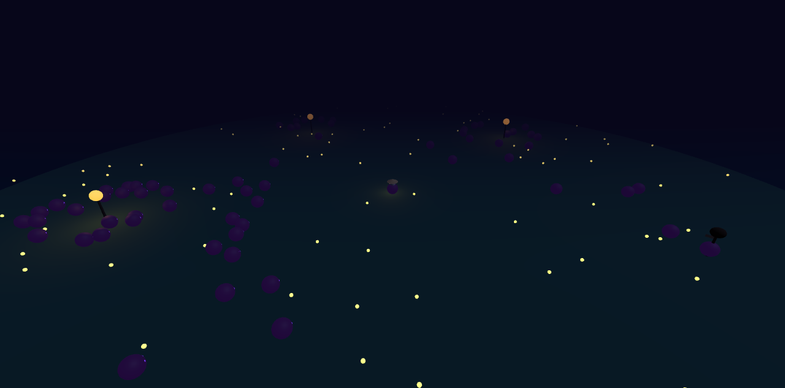

# Đảo Đèn Lồng

> Game 3D góc nhìn thứ ba, làm cho lab **Day 12 · AI SDLC**. Cá nhân, 1 MSSV.
> **Video demo (dưới 5 phút):** [docs/demo/demo.mp4](docs/demo/demo.mp4) — chơi trực tiếp, cảnh benchmark, và bằng chứng test/bench/soak.



**Trạng thái:** v1.0.0 (Phase 4). Tag `phase-1` … `phase-4`.

**Chưa đạt (ghi trung thực):** bench theo yêu cầu ticket (vsync tắt) chưa đạt ngưỡng FPS trên iGPU này; soak ở chế độ mặc định vượt ngưỡng bộ nhớ. Chi tiết: [Còn thiếu](#còn-thiếu-ghi-trung-thực) và [docs/notes/phase-4-eval.md](docs/notes/phase-4-eval.md).

## Mô tả

Mây, một đứa trẻ giữ đèn, đứng trên các hòn đảo giữa đêm sương. Mây gom đom đóm để thắp Đèn Lồng Lớn, tỏa sáng để xua Bóng Mực, và giữ cho đèn còn dầu tới bình minh. Ba Đêm:

| Đêm | Đảo | Thời gian | Đèn | Đặc điểm |
|---|---|---|---|---|
| 1 | Đảo Bến | 240 s | 5 | đảo tròn, đom đóm, Bóng Mực |
| 2 | Đảo Cau | 270 s | 6 | hai đảo, cầu tre, bục nhảy, Gió Lạc, Bùa Gió |
| 3 | Đảo Chuông | 300 s | 7 | ba tầng, dốc, vách, tháp, gió mạnh |

Thắng khi Mây còn sống lúc bình minh và đủ đèn còn sáng (3/5, 4/6, 5/7). Điểm tổng là tổng điểm các Đêm đã thắng; điểm cao được ghi vào bảng xếp hạng.

## Yêu cầu hệ thống

- Node.js 20 trở lên (không cần `npm install`: không có phụ thuộc cài đặt).
- Trình duyệt có WebGL (Chrome, Edge, Firefox hoặc Safari bản mới).
- Internet để tải three.js r160 từ CDN.
- Chạy được trên macOS và Linux. Windows: chạy được trong trình duyệt, chưa thử CLI.

## Cài đặt và chạy (3 lệnh)

```bash
git clone https://github.com/LeHongQuanMarble/K5-L3A-DAY12-LeHongQuan-2A202603705-AI-SDLC-Dao-Den-Long.git
cd K5-L3A-DAY12-LeHongQuan-2A202603705-AI-SDLC-Dao-Den-Long
npm start        # mở http://127.0.0.1:8080/
```

## Điều khiển (mặc định, đổi được trong Cài đặt)

| Phím | Tác dụng |
|---|---|
| W A S D | Di chuyển (theo hướng camera) |
| ← / → | Xoay camera |
| Space | Nhảy |
| Shift | Lướt (14 m/s, 0.2 s, hồi chiêu 1.5 s) |
| E | Nạp đom đóm vào đèn gần nhất; châm dầu đèn đang sáng |
| F | Tỏa sáng: 3 đom đóm, choáng Bóng Mực trong 2 s, đẩy 4 m |
| Esc | Tạm dừng |
| R | Chơi lại chiến dịch từ Đêm 1 |

Trong Cài đặt: đổi từng phím (báo khi trùng phím), khôi phục mặc định, giảm chuyển động (tắt chớp màn hình), chữ lớn ×1.25, bảng màu dễ phân biệt.

## Kiểm chứng

```bash
npm test          # test node:test: luật, contract, bảng xếp hạng, cài đặt, bench
npm run e2e       # kiểm thử trình duyệt thật (cần google-chrome): 17 kiểm tra
npm run check     # kiểm tra cú pháp
npm run evidence  # chạy kịch bản headless bằng CLI thật -> docs/proof/phase-3/
```

### Headless

```bash
node bin/headless.js --seed 1 --night 1 --ticks 600 --out run.jsonl \
  [--scenario scenarios/win-by-deposit.json] [--inputs inputs/deposit-win.json]
```

`--night 1|2|3`. Exit code `0` xong, `1` gọi sai, `2` scenario hoặc inputs sai. Cùng seed, scenario và inputs cho đầu ra byte-giống-nhau. Hợp đồng: [game.contract.json](game.contract.json) (Test Contract v1.3).

### Benchmark (Chrome headless)

```bash
node --expose-gc bin/bench.js --seed 42 --duration 30 --out bench.json
```

Cảnh chuẩn: Đêm 1, 200 Bóng Mực wander, 100 đom đóm, L1–L3 sáng, Mây đứng yên, camera vòng tròn 30 m ở Y = 15, 15 s một vòng. Ngưỡng trên máy chấm: avg_fps ≥ 60, p1_low_fps ≥ 30, load_ms ≤ 10000. Cấu hình theo ticket là vsync tắt (`vsync_off: true`).

**Kết quả đo (iGPU Intel Iris Xe, Chrome headless, 30 s, seed 42):**

| Chế độ | Trạng thái | avg_fps | p1_low_fps | frame_ms_p95 | Bằng chứng |
|---|---|---|---|---|---|
| Theo yêu cầu ticket: vsync tắt | **Chưa đạt** (p1 < 30). Có các đợt dừng 200–500 ms định kỳ từ driver GPU | 365.6 | 4.4 | 1.2 | [bench-vsync-off.json](docs/proof/phase-4/bench-vsync-off.json) |
| Tham khảo: vsync bật (`--vsync 1`) | Đạt ngưỡng trên máy này, **không** phải kết quả theo yêu cầu | 60.0 | 59.5 | 16.8 | [bench.json](docs/proof/phase-4/bench.json) (ghi `targets_met: true` vì đo ở chế độ vsync bật) |

Chi tiết nguyên nhân và cách đo lại: [docs/notes/phase-4-eval.md](docs/notes/phase-4-eval.md). Máy chấm sẽ đo lại trên cấu hình của giảng viên.

### Soak

```bash
npm run soak     # = node --expose-gc --jitless bin/soak.js --seed 7 --nights 10 --out soak.json
```

Chạy 10 Đêm liên tiếp trong một tiến trình, với `--jitless` (đúng lệnh `npm run soak` và `soak_cmd` trong contract). Crash = 0 ở cả hai chế độ:

| Chế độ | Bộ nhớ đầu → cuối | Ngưỡng mem_end ≤ 1.2 × mem_start | Bằng chứng |
|---|---|---|---|
| `--jitless` (lệnh chuẩn) | 48.3 → 51.7 MB | đạt | [soak.json](docs/proof/phase-4/soak.json) |
| Mặc định (có JIT) | 51.1 → 67.4 MB | **vượt ngưỡng** | [soak-jit-default.json](docs/proof/phase-4/soak-jit-default.json) |

Phần tăng ở chế độ mặc định là bộ nhớ V8 cấp một lần khi biên dịch JIT, heap JavaScript phẳng. Đây là giải thích, không phải lý do để coi là đạt. Xem [đánh giá](docs/notes/phase-4-eval.md).

### Bảng xếp hạng

Điểm được lưu trên trình duyệt (top 10). Xuất ra file:

```bash
node bin/game.js --export-leaderboard out.json
```

Trên trình duyệt, nút "Tải JSON" trong Bảng xếp hạng tải file cùng định dạng `{"entries": [...]}`; CLI đọc `~/.dao-den-long/leaderboard.json` hoặc đường dẫn trong biến `DDL_LEADERBOARD`.

## Cấu trúc

```text
src/tuning.js        số liệu của game (nguồn duy nhất) + điểm
src/world.js         bản đồ ba Đêm
src/sim.js           lõi mô phỏng (không phụ thuộc hiển thị), có chế độ bench
src/scenario.js      kiểm tra scenario / inputs
src/headless.js, src/cli.js     chạy headless và exit code
src/leaderboard.js   bảng xếp hạng (thuần logic)
src/settings.js      phím và tùy chọn (thuần logic)
src/soak.js, src/benchstats.js  soak test và công thức chỉ số bench
bin/game.js          điểm vào: máy chủ tĩnh hoặc --export-leaderboard
bin/headless.js, bin/soak.js, bin/bench.js
web/                 bản trình duyệt (three.js r160)
scripts/             máy chủ tĩnh, sinh bằng chứng, sinh contract
tests/               test node:test
specs/phase-1..4/    spec và tasks
docs/adr/            quyết định thiết kế
docs/notes/          giả định, thay đổi test, nhật ký AI, đánh giá, retro
docs/proof/          bằng chứng đã sinh (phase-1..4, bench, soak, ảnh)
CHANGELOG.md, CREDITS.md, LICENSE, AGENTS.md
```

## Còn thiếu (ghi trung thực)

- Bench theo yêu cầu (vsync tắt, p1 ≥ 30) **chưa đạt** trên iGPU này. Chỉ bản vsync bật đạt ngưỡng, và đó chỉ là số tham khảo.
- Soak đạt với `--jitless` (lệnh chuẩn); chế độ mặc định có JIT vượt ngưỡng bộ nhớ.
- Chưa kiểm tra trên Windows và macOS; chưa đo trên máy chấm của giảng viên.

## Sáng tạo của tôi

Đoạn giới thiệu từng Đêm (văn bản do tôi viết), âm thanh tổng hợp, và bảng màu theo ticket. Luật và số liệu không đổi so với ticket.

Bằng chứng: màn giới thiệu [03-intro.png](docs/proof/phase-4/e2e/03-intro.png), bảng xếp hạng [06-leaderboard.png](docs/proof/phase-4/e2e/06-leaderboard.png), cài đặt [02-settings.png](docs/proof/phase-4/e2e/02-settings.png). Các luồng này nằm trong E2E 17/17 ([e2e.json](docs/proof/phase-4/e2e/e2e.json)). Âm thanh tổng hợp bằng mã (`web/audio.js`), không dùng file ngoài; E2E không kiểm tra âm thanh.

## Giấy phép và nguồn

Mã nguồn theo [LICENSE](LICENSE) (MIT). Nguồn và giấy phép thư viện, asset và công cụ AI: [CREDITS.md](CREDITS.md). Thay đổi theo phase: [CHANGELOG.md](CHANGELOG.md).
